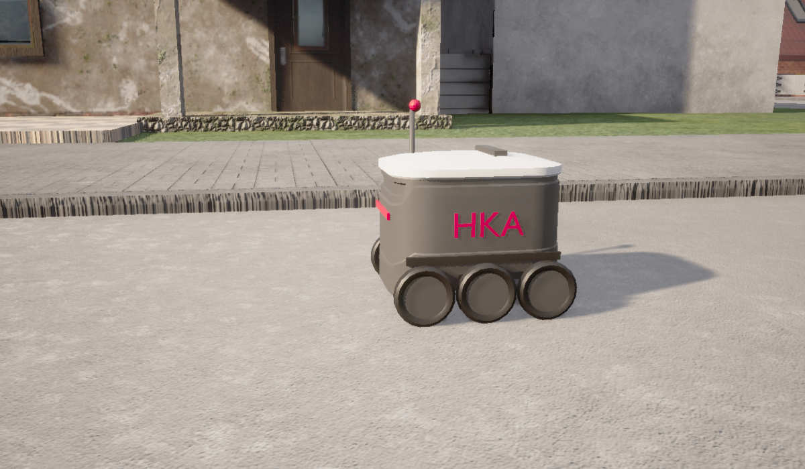

# Starship-Lieferroboter (HKA-Design) für CARLA

Ein 6-rädriger Lieferroboter nach Vorbild des Starship-Bots, als fahrbares CARLA-Fahrzeug
(`vehicle.starship.bot`) mit kompletter Sensor-Ausstattung.

Entwickelt und getestet mit **CARLA Source-Build, Branch `ue4-dev` (Commit `ac006dd1b`, Python-API 0.9.16)**
und **Unreal Engine 4.26.2 (CARLA-Fork)**. Für CARLA 0.10 (Unreal 5, Chaos) siehe
[docs/CARLA_0.10.md](docs/CARLA_0.10.md).



## Inhalt

| Ordner | Inhalt |
| --- | --- |
| `models/` | FBX und Blender-Dateien. **`starship_hka_v5.fbx` ist die aktuelle Version** (HKA-Design). `starship_carla_v4.fbx` = gleiches Skelett, ursprüngliches Starship-Design. |
| `unreal/ue4.26_vehicle3/` | Fertige Unreal-4.26-Assets aus `Content/Carla/vehicle3` (Blueprint, Räder, Mesh, Skelett, Physics Asset, AnimBP, Materialien). |
| `config/starship_values.json` | Alle Fahrzeugwerte, direkt aus dem Editor ausgelesen. |
| `config/starship_sensors.json` | Sensor-Konfiguration: Typ, Position, Ausrichtung, Attribute. |
| `scripts/carla/` | Python-Clients: Sensoren spawnen und anzeigen, Fahren, Geschwindigkeitstest. |
| `scripts/unreal_editor/` | Editor-Python: FBX-Import, Werte auslesen. |
| `docs/` | [Fahrzeugwerte](docs/FAHRZEUGWERTE.md), [Sensorik mit Begründung](docs/SENSORIK.md), [Umstieg auf CARLA 0.10](docs/CARLA_0.10.md), Bilder. |
| `ki_kontext/` | [Projektzusammenfassung für KI-Assistenten](ki_kontext/00_LIES_MICH_ZUERST.md): Stand, Umgebung, gelöste Probleme, offene Punkte. |

## Schnellstart (CARLA UE4, gleicher Stand)

1. Den Ordner `unreal/ue4.26_vehicle3/` nach `CarlaUE4/Content/Carla/vehicle3/` kopieren.
   Der Pfad muss genau so heißen, weil die Assets sich gegenseitig über `/Game/Carla/vehicle3/` referenzieren.
2. Editor starten, `Content/Carla/Blueprints/Vehicles/VehicleFactory` öffnen, unter **Vehicles** einen Eintrag hinzufügen:
   Make `starship`, Model `bot`, Class `BP_Starship`, Number of Wheels `4`. Compile, Save All.
3. Play drücken, dann im Terminal:

   ```bash
   pip install pygame numpy
   python scripts/carla/starship_drive.py
   python scripts/carla/starship_sensors.py
   ```

Die Rad-Blueprints brauchen CARLAs `CommonTireConfig` (`/Game/Carla/Blueprints/Vehicles/CommonTireConfig`);
die ist in jedem CARLA-UE4-Projekt vorhanden.

## Selbst importieren (andere CARLA-Version)

1. `models/starship_hka_v5.fbx` als **Skeletal Mesh** importieren: Skeleton *None*, Create Physics Asset an,
   Import Animations aus. Die FBX ist in cm, ohne Skalierung, Wurzelknochen `VehicleBase`.
2. Physics Asset: alle Bodies bis auf `VehicleBase` löschen, dort eine Box 55 × 45 × 33 cm,
   Mitte 23,45 cm über dem Knochen (Unterkante 16 cm über Boden).
3. AnimBP (Parent `VehicleAnimInstance`): `Mesh Space Ref Pose` → `Wheel Handler` → 2 × `Copy Bone`
   (`Wheel_Rear_Left` → `Wheel_Middle_Left`, `Wheel_Rear_Right` → `Wheel_Middle_Right`, nur Rotation)
   → `Component To Local` → Output.
4. Vier Rad-Blueprints und das Fahrzeug-Blueprint mit den Werten aus [docs/FAHRZEUGWERTE.md](docs/FAHRZEUGWERTE.md) anlegen.
5. In der VehicleFactory registrieren (siehe oben).

## Bekannte Stolperfallen

- **Skalierung:** Blender-Exporte mit Knoten-Skalierung 100 lassen den Bot durch die Welt fallen. Die FBX hier sind korrigiert.
- **Knochen-Ausrichtung:** Alle Knochen müssen ohne Rotation sein (in UE identische Achsen), sonst rechnet PhysX das Fahrwerk seitwärts.
- **VehicleBounds** braucht `NoCollision`, sonst steht der Bot auf dieser Box statt auf den Rädern.
- **Tire Config** muss an allen Rädern gesetzt sein, sonst stürzt CARLA beim Spawnen ab.
- **Speicher:** Mit 16 GB RAM läuft der Editor mit Town10 oft voll. Town02 verwenden und nie zwei Editoren gleichzeitig öffnen.
- Die Mittelräder werden mit PhysX nicht simuliert (4W-Fahrwerk), nur optisch mitgedreht.
